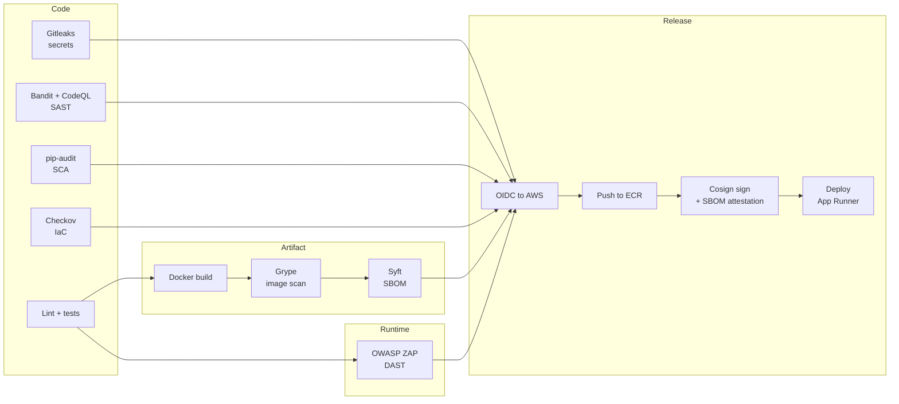

# secure-pipeline-demo

A small Python API shipped through a CI/CD pipeline that has a security control at every stage:
code, dependencies, infrastructure, container image, running application, and release.

The application is intentionally tiny. The pipeline is the product.

<!-- After your first push, replace OWNER/REPO and uncomment:
[](https://github.com/OWNER/REPO/actions/workflows/pipeline.yml)
-->

## Pipeline



Nothing is released unless every gate before it passes. The release job runs only on `main`.

## Security controls

| Stage | Control | Tool | Blocks the build when |
|---|---|---|---|
| Commit | Secret scanning over full git history | Gitleaks | Any secret is detected |
| Code | Static analysis | Bandit, CodeQL (`security-extended`), Ruff `S` rules | Bandit or Ruff finds an issue; CodeQL reports to the Security tab |
| Code | Security regression tests | pytest | Auth, validation, or header tests fail, or coverage drops below 90% |
| Dependencies | Known-vulnerability audit | pip-audit | Any pinned dependency has a known CVE |
| Dependencies | Automated updates | Dependabot | n/a (opens PRs for pip, Docker, Actions, Terraform) |
| Infrastructure | Policy checks on Terraform, Dockerfile, workflows | Checkov | Any failed policy |
| Image | Vulnerability scan | Grype | A fixable High or Critical CVE exists |
| Image | Software bill of materials | Syft (SPDX) | n/a (stored as artifact, attested at release) |
| Running app | Dynamic scan against the hardened container | OWASP ZAP baseline | Report-only for now (see Known limitations) |
| Release | No stored cloud credentials | GitHub OIDC to AWS IAM | n/a |
| Release | Image signing and SBOM attestation | Cosign keyless (Sigstore) | Signing fails |
| Release | Immutable, scanned, encrypted registry | ECR | n/a |
| Runtime | Least-privilege roles, secret from SSM | IAM, App Runner | n/a |

### Hardening choices worth pointing out

The workflow sets `permissions: contents: read` globally and each job opts in to anything more.
Checkouts use `persist-credentials: false`. The AWS role can only be assumed by this repository's
`production` environment, and its policy is scoped to one ECR repository and one App Runner
service. Images are tagged by commit SHA in an immutable repository and signed by digest. The container runs as a non-root user with a read-only filesystem and all capabilities
dropped, and the same flags are used during the DAST stage. The API fails closed when its key is
not configured and compares keys in constant time.

## Run it locally

```bash
python -m venv .venv && source .venv/bin/activate
make install
make all          # lint, tests, SAST, dependency audit
make run          # build and start the hardened container on :8080

curl localhost:8080/healthz
curl -X POST localhost:8080/notes -H 'X-API-Key: local-dev-key' \
     -H 'Content-Type: application/json' -d '{"title":"hi","body":"there"}'
```

## Set it up on GitHub

1. Create a **public** repository and push this code. Public repositories get CodeQL and the
   Security tab for free. Stages 1 to 3 of the pipeline run immediately with no AWS account.
2. In Settings, enable Dependabot alerts, secret scanning with push protection, and a branch
   protection rule on `main` that requires the pipeline checks and a pull request.
3. Create an environment named `production` (Settings, Environments). Restrict its deployment
   branches to `main` and, optionally, add yourself as a required reviewer.

## Optional: release to AWS

The `publish` job stays skipped until the `AWS_ROLE_ARN` repository variable exists.

```bash
cd terraform
cp example.tfvars terraform.tfvars      # set github_repository
terraform init && terraform apply
```

Add repository variables (Settings, Secrets and variables, Actions, Variables): `AWS_ROLE_ARN`
from the Terraform output, and `AWS_REGION`. The next push to `main` builds, pushes, and signs the
image.

To run the service, store the API key outside Terraform, then enable App Runner:

```bash
aws ssm put-parameter --name /secure-notes-api/api-key --type SecureString \
    --value "$(openssl rand -hex 32)"
# in terraform.tfvars: create_app_runner = true, initial_image_tag = "<commit SHA>"
terraform apply
```

Add `APPRUNNER_SERVICE_ARN` and `APPRUNNER_ACCESS_ROLE_ARN` from the outputs as repository
variables. App Runner and ECR cost a few dollars a month; run `terraform destroy` when finished.

### Verify a released image

```bash
cosign verify <account>.dkr.ecr.<region>.amazonaws.com/secure-notes-api@sha256:<digest> \
  --certificate-identity-regexp '^https://github.com/OWNER/REPO/\.github/workflows/pipeline\.yml@refs/heads/main$' \
  --certificate-oidc-issuer https://token.actions.githubusercontent.com
```

## AI-assisted development

The repository is set up for work with an AI coding agent using the
[ECC](https://github.com/affaan-m/ECC) plugin for Claude Code, which drives a
plan, test, implement, review, verify loop. [`CLAUDE.md`](CLAUDE.md) gives the agent the project
commands and a list of security invariants it must not weaken, such as OIDC-only cloud access,
read-only default workflow permissions and blocking security gates.

The agent's configuration is treated as part of the supply chain: installed from official sources
at a pinned version, limited to the components this stack needs, with hooks off by default and
changes reviewed in pull requests. See
[docs/ai-assisted-development.md](docs/ai-assisted-development.md) for setup and the reasoning.

## Known limitations and next steps

- AgentShield, ECC's scanner for agent configuration, is not yet a pipeline stage.

- Third-party actions are pinned by version tag. Pinning each to a full commit SHA is stronger,
  and Dependabot will keep SHA pins updated.
- ZAP runs in report-only mode. Once the baseline is clean, set `fail_action: true`.
- `requirements.txt` pins direct dependencies only. Hash-pinned transitive locks
  (`pip-compile --generate-hashes`) would close that gap.
- The base image is pinned by tag. Pinning by digest makes builds reproducible.
- Deployment does not yet verify the signature. With ECS or EKS, an admission policy
  (for example Kyverno `verifyImages`) would enforce it.
- Terraform state is local. Use the commented S3 backend for anything shared.
- The API uses a single shared key and in-memory storage, which is enough for a demo only.

See [docs/threat-model.md](docs/threat-model.md) for the threats each control addresses and
[SECURITY.md](SECURITY.md) for how to report a vulnerability.
